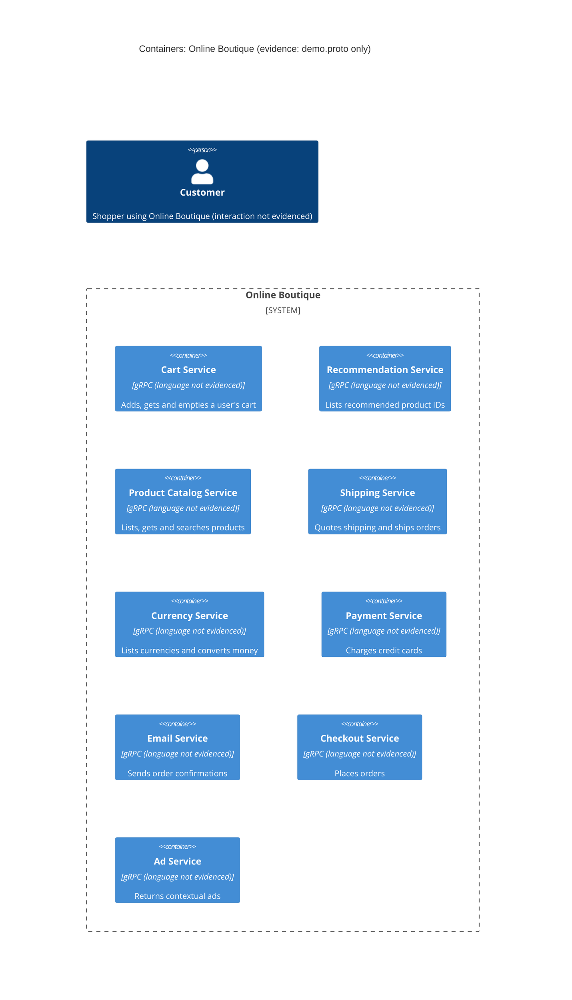

# Task 1 (Run A): Recovered architecture: Online Boutique

## 1. Agent

Claude Code (Anthropic), model Claude Opus 5.5 (`claude-opus-5-5`).

## 2. Files read

- `prompts/1-recover-architecture.md` (task instructions)
- `system/online-boutique/protos/demo.proto` (the only evidence)

## 3. Containers table

`demo.proto` defines gRPC service interfaces (`syntax = "proto3"`, `package hipstershop`). Each `service` block is taken as one container. The proto describes interfaces only, so the implementation language of each service is **not evidenced in the provided files**. (`option go_package` (line 19) only configures Go code generation. It does not show that any service is written in Go.)

| # | Container | Technology / language | Responsibility (from RPCs) | Evidence |
|---|-----------|----------------------|----------------------------|----------|
| 1 | Cart Service | gRPC interface (proto3); language not evidenced | Add items to a user's cart, read it, empty it | `system/online-boutique/protos/demo.proto` (`service CartService`, lines 23–27: `AddItem`, `GetCart`, `EmptyCart`) |
| 2 | Recommendation Service | gRPC interface (proto3); language not evidenced | Return recommended product IDs for a user and a list of products | `demo.proto` (`service RecommendationService`, lines 56–58: `ListRecommendations`) |
| 3 | Product Catalog Service | gRPC interface (proto3); language not evidenced | List, get and search products (name, description, picture, USD price, categories) | `demo.proto` (`service ProductCatalogService`, lines 71–75: `ListProducts`, `GetProduct`, `SearchProducts`; `message Product`) |
| 4 | Shipping Service | gRPC interface (proto3); language not evidenced | Quote shipping cost and ship an order (returns a tracking ID) | `demo.proto` (`service ShippingService`, lines 107–110: `GetQuote`, `ShipOrder`) |
| 5 | Currency Service | gRPC interface (proto3); language not evidenced | List supported currencies and convert `Money` between ISO 4217 currencies | `demo.proto` (`service CurrencyService`, lines 140–143: `GetSupportedCurrencies`, `Convert`) |
| 6 | Payment Service | gRPC interface (proto3); language not evidenced | Charge a credit card for an amount and return a transaction ID | `demo.proto` (`service PaymentService`, lines 177–179: `Charge`) |
| 7 | Email Service | gRPC interface (proto3); language not evidenced | Send an order confirmation to an email address | `demo.proto` (`service EmailService`, lines 199–201: `SendOrderConfirmation`) |
| 8 | Checkout Service | gRPC interface (proto3); language not evidenced | Place an order for a user (currency, address, email, credit card) and return an `OrderResult` | `demo.proto` (`service CheckoutService`, lines 224–226: `PlaceOrder`) |
| 9 | Ad Service | gRPC interface (proto3); language not evidenced | Return ads (text and redirect URL) for page context keywords | `demo.proto` (`service AdService`, lines 243–245: `GetAds`) |

No data stores or message brokers are evidenced in the provided file.

## 4. Dependencies table

A `.proto` file declares what each service **offers**. It does not declare which service **calls** which. No runtime dependency (caller → callee) is therefore evidenced in the provided file.

| Caller → Callee | Protocol | Evidence |
|-----------------|----------|----------|
| *(none evidenced)* | n/a | Not evidenced in the provided files |

The only evidenced protocol is that every listed service exposes a **gRPC** interface (`service … { rpc … }` in `demo.proto`). Likely dependencies are listed under **Gaps**, labelled **[Inferred]**.

## 5. Mermaid diagram

The diagram matches the tables. It has no `Rel` lines because no dependency is evidenced. The end user `Person` is included because the diagram format requires one. No interaction between the user and the system is evidenced (see Gaps).

## 6. Gaps

| Gap | What the proto suggests | File that would settle it |
|-----|-------------------------|---------------------------|
| **Who calls whom** (all dependencies) | **[Inferred]** `PlaceOrderRequest` carries a user ID, currency, `Address`, `email` and `CreditCardInfo`, and `OrderResult` contains `shipping_tracking_id` and `shipping_cost`. So Checkout probably calls Cart (`GetCart`/`EmptyCart`), Product Catalog (`GetProduct`), Currency (`Convert`), Shipping (`GetQuote`/`ShipOrder`), Payment (`Charge`) and Email (`SendOrderConfirmation`). | `system/online-boutique/kubernetes-manifests/checkoutservice.yaml` (`*_SERVICE_ADDR` env vars) or the checkout service source |
| **User-facing entry point (frontend / web UI)** and how the customer reaches the system | No frontend service is defined in the proto. **[Inferred]** Some web frontend calls Cart, Catalog, Recommendation, Currency, Shipping, Checkout and Ad, and the customer uses it over HTTP(S). | `system/online-boutique/kubernetes-manifests/frontend.yaml` and the frontend source |
| **Implementation language of each service** | Not evidenced. `go_package` (line 19) is only a code-generation option. | Each service's source folder or Dockerfile under `system/online-boutique/src/` |
| **Data stores** (e.g. where carts are persisted) | Cart state is keyed by `user_id`, so it is stored somewhere. The store is not evidenced. | `system/online-boutique/kubernetes-manifests/cartservice.yaml` and any data-store manifest |
| **Where product data comes from** | Not evidenced (could be a file, DB or in-memory). | Product catalog service source |
| **External systems** (real payment gateway, email provider) | Not evidenced. The proto does not show whether Payment or Email call external providers. | Payment and email service source |
| **Message brokers / async communication** | None in the proto. All interfaces are unary gRPC. | Kubernetes manifests and service source |
| **Ports, addresses, deployment** | Not evidenced. | `system/online-boutique/kubernetes-manifests/` |
