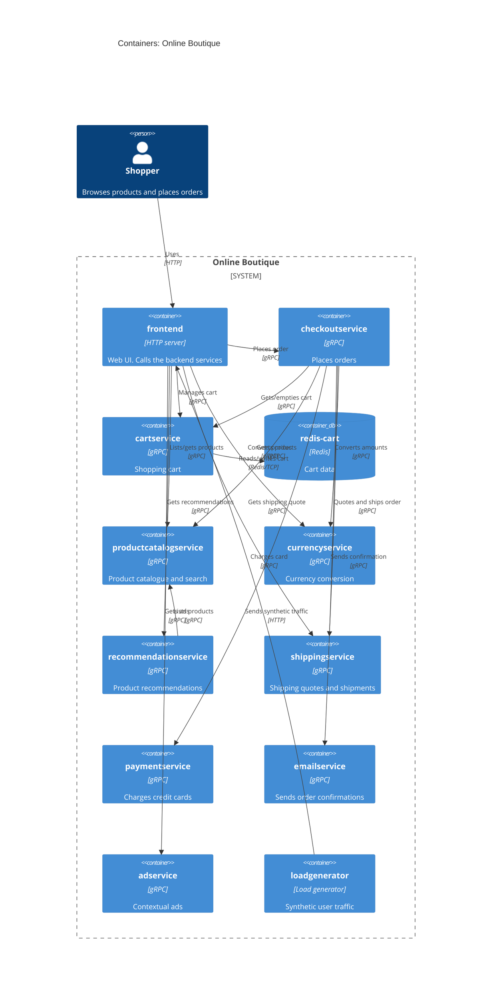

# 1B: Recovered architecture (C4 container level)

## 1. Agent

Claude Code (Anthropic CLI), model **Claude Opus 5.5** (`claude-opus-5-5`).

## 2. Files read

All paths are relative to `system/online-boutique/`.

- `protos/demo.proto`
- `kubernetes-manifests/README.md`
- `kubernetes-manifests/kustomization.yaml`
- `kubernetes-manifests/adservice.yaml`
- `kubernetes-manifests/cartservice.yaml`
- `kubernetes-manifests/checkoutservice.yaml`
- `kubernetes-manifests/currencyservice.yaml`
- `kubernetes-manifests/emailservice.yaml`
- `kubernetes-manifests/frontend.yaml`
- `kubernetes-manifests/loadgenerator.yaml`
- `kubernetes-manifests/paymentservice.yaml`
- `kubernetes-manifests/productcatalogservice.yaml`
- `kubernetes-manifests/recommendationservice.yaml`
- `kubernetes-manifests/shippingservice.yaml`

## 3. Containers table

The proto services map to Deployments by name (e.g. `service CartService` ↔ Deployment `cartservice`). The evidence never says what language each service is written in, because the manifests reference images only by bare name (`image: cartservice`). So the technology column gives the protocol and runtime only.

| Container | Technology / language | Responsibility | Evidence |
|---|---|---|---|
| `frontend` | HTTP server on port 8080, exposed via a `LoadBalancer` Service. Language not evidenced | Web UI for shoppers. Calls the backend services | `kubernetes-manifests/frontend.yaml` (Deployment `frontend`, `containerPort: 8080`, `/_healthz` probes, Service `frontend-external` `type: LoadBalancer`) |
| `cartservice` | gRPC server on port 7070. Language not evidenced | Shopping cart: `AddItem`, `GetCart`, `EmptyCart` | `protos/demo.proto` (`service CartService`); `kubernetes-manifests/cartservice.yaml` (Service port `name: grpc`, `7070`) |
| `redis-cart` (data store) | Redis (`image: redis:alpine`), port 6379, `emptyDir` volume | Stores cart data for `cartservice` | `kubernetes-manifests/cartservice.yaml` (Deployment `redis-cart`, `image: redis:alpine`, volume `redis-data: emptyDir`) |
| `productcatalogservice` | gRPC server on port 3550. Language not evidenced | Product catalogue: `ListProducts`, `GetProduct`, `SearchProducts` | `protos/demo.proto` (`service ProductCatalogService`); `kubernetes-manifests/productcatalogservice.yaml` (port `grpc` 3550) |
| `currencyservice` | gRPC server on port 7000. Language not evidenced | Currency conversion: `GetSupportedCurrencies`, `Convert` | `protos/demo.proto` (`service CurrencyService`); `kubernetes-manifests/currencyservice.yaml` (port `grpc` 7000) |
| `recommendationservice` | gRPC server on port 8080. Language not evidenced | Product recommendations: `ListRecommendations` | `protos/demo.proto` (`service RecommendationService`); `kubernetes-manifests/recommendationservice.yaml` (port `grpc` 8080) |
| `shippingservice` | gRPC server on port 50051. Language not evidenced | Shipping quotes and shipments: `GetQuote`, `ShipOrder` | `protos/demo.proto` (`service ShippingService`); `kubernetes-manifests/shippingservice.yaml` (port `grpc` 50051) |
| `checkoutservice` | gRPC server on port 5050. Language not evidenced | Order placement: `PlaceOrder`, which returns an `OrderResult` | `protos/demo.proto` (`service CheckoutService`); `kubernetes-manifests/checkoutservice.yaml` (port `grpc` 5050) |
| `paymentservice` | gRPC server on port 50051. Language not evidenced | Charges a credit card: `Charge` | `protos/demo.proto` (`service PaymentService`); `kubernetes-manifests/paymentservice.yaml` (port `grpc` 50051) |
| `emailservice` | gRPC server (Service port 5000 → container port 8080). Language not evidenced | Sends order confirmations: `SendOrderConfirmation` | `protos/demo.proto` (`service EmailService`); `kubernetes-manifests/emailservice.yaml` (Service port `grpc` 5000, `targetPort: 8080`) |
| `adservice` | gRPC server on port 9555. Language not evidenced | Contextual ads: `GetAds` | `protos/demo.proto` (`service AdService`); `kubernetes-manifests/adservice.yaml` (port `grpc` 9555) |
| `loadgenerator` | Load-generating client (`USERS=10`, `RATE=1`). Language not evidenced | Sends synthetic user traffic to `frontend`. Not in the default kustomization (commented out) | `kubernetes-manifests/loadgenerator.yaml` (env `FRONTEND_ADDR`, `USERS`, `RATE`); `kubernetes-manifests/kustomization.yaml` (`# - loadgenerator.yaml`) |

## 4. Dependencies table

Protocol evidence: every callee's Kubernetes Service names its port `grpc` and uses `grpc:` readiness and liveness probes. The RPCs are defined in `protos/demo.proto`. The exception is `redis-cart`, whose port is named `tcp-redis`.

| Caller → callee | Protocol | Evidence (file · symbol / env var) |
|---|---|---|
| Shopper → `frontend` | HTTP (port 80 → 8080) | `kubernetes-manifests/frontend.yaml` · Service `frontend-external` (`type: LoadBalancer`, port `name: http`) |
| `loadgenerator` → `frontend` | HTTP | `kubernetes-manifests/loadgenerator.yaml` · `FRONTEND_ADDR=frontend:80`; init container `wget http://${FRONTEND_ADDR}` |
| `frontend` → `productcatalogservice` | gRPC | `kubernetes-manifests/frontend.yaml` · `PRODUCT_CATALOG_SERVICE_ADDR=productcatalogservice:3550` |
| `frontend` → `currencyservice` | gRPC | `kubernetes-manifests/frontend.yaml` · `CURRENCY_SERVICE_ADDR=currencyservice:7000` |
| `frontend` → `cartservice` | gRPC | `kubernetes-manifests/frontend.yaml` · `CART_SERVICE_ADDR=cartservice:7070` |
| `frontend` → `recommendationservice` | gRPC | `kubernetes-manifests/frontend.yaml` · `RECOMMENDATION_SERVICE_ADDR=recommendationservice:8080` |
| `frontend` → `shippingservice` | gRPC | `kubernetes-manifests/frontend.yaml` · `SHIPPING_SERVICE_ADDR=shippingservice:50051` |
| `frontend` → `checkoutservice` | gRPC | `kubernetes-manifests/frontend.yaml` · `CHECKOUT_SERVICE_ADDR=checkoutservice:5050` |
| `frontend` → `adservice` | gRPC | `kubernetes-manifests/frontend.yaml` · `AD_SERVICE_ADDR=adservice:9555` |
| `checkoutservice` → `productcatalogservice` | gRPC | `kubernetes-manifests/checkoutservice.yaml` · `PRODUCT_CATALOG_SERVICE_ADDR=productcatalogservice:3550` |
| `checkoutservice` → `shippingservice` | gRPC | `kubernetes-manifests/checkoutservice.yaml` · `SHIPPING_SERVICE_ADDR=shippingservice:50051` |
| `checkoutservice` → `paymentservice` | gRPC | `kubernetes-manifests/checkoutservice.yaml` · `PAYMENT_SERVICE_ADDR=paymentservice:50051` |
| `checkoutservice` → `emailservice` | gRPC | `kubernetes-manifests/checkoutservice.yaml` · `EMAIL_SERVICE_ADDR=emailservice:5000` |
| `checkoutservice` → `currencyservice` | gRPC | `kubernetes-manifests/checkoutservice.yaml` · `CURRENCY_SERVICE_ADDR=currencyservice:7000` |
| `checkoutservice` → `cartservice` | gRPC | `kubernetes-manifests/checkoutservice.yaml` · `CART_SERVICE_ADDR=cartservice:7070` |
| `recommendationservice` → `productcatalogservice` | gRPC | `kubernetes-manifests/recommendationservice.yaml` · `PRODUCT_CATALOG_SERVICE_ADDR=productcatalogservice:3550` |
| `cartservice` → `redis-cart` | Redis protocol over TCP | `kubernetes-manifests/cartservice.yaml` · `REDIS_ADDR=redis-cart:6379`; Service `redis-cart` port `tcp-redis` |

## 5. Mermaid diagram

No `System_Ext` appears because the evidence shows no external system. In particular, `paymentservice` and `emailservice` declare no outbound address (see Gaps).

The Rel labels name RPCs from `demo.proto`. Which RPCs each caller actually uses is **[Inferred]** from names and message types. The manifests only show *that* a caller is configured with a callee's address.

## 6. Gaps

| Gap | Why it is open | File that would settle it |
|---|---|---|
| Implementation language of each service | Manifests use bare image names (`image: frontend`, …). The proto has a `go_package` option, which only configures Go code generation | Each service's source folder or `Dockerfile` under `system/online-boutique/src/<service>/` |
| `shoppingassistantservice` | `frontend.yaml` sets `SHOPPING_ASSISTANT_SERVICE_ADDR=shoppingassistantservice:80`, but no manifest for it is in the evidence and `ENABLE_ASSISTANT` is commented out. `kustomization.yaml` lists it only as a commented-out component. **Left out of the diagram** | `kustomize/components/shopping-assistant/` and the frontend source code |
| Whether `frontend` really calls every configured address, and which RPCs | Env vars show configuration, not calls | Frontend source (`src/frontend/`), e.g. its handlers and RPC client code |
| Real external payment or email providers | `paymentservice` and `emailservice` have no outbound env vars, so they could be stubs or could have hard-coded endpoints | `src/paymentservice/`, `src/emailservice/` |
| Whether `redis-cart` keeps data across restarts | Uses `emptyDir`, so data is pod-scoped. Alternatives (Memorystore, AlloyDB, Spanner) appear only as commented-out components | `kustomize/components/memorystore/`, `alloydb/`, `spanner/`, and the cartservice source |
| Optional `packaging service` (external HTTP) | Only appears as a commented-out `PACKAGING_SERVICE_URL` in `frontend.yaml` | Frontend source and its deployment docs |
| Whether `loadgenerator` is part of the production system | Commented out of `kustomization.yaml` ("skaffold … will be used"). Shown in the diagram because its manifest exists in the evidence folder | `skaffold.yaml`, `release/` manifests |
| Observability or tracing back-ends (e.g. a collector) | Only `ENABLE_PROFILER`/`DISABLE_PROFILER` flags and a commented-out `google-cloud-operations` component | `kustomize/components/google-cloud-operations/` |
| Transport security and service mesh | `sidecar.istio.io/rewriteAppHTTPProbers` annotation hints at Istio, but no mesh config is in the evidence | `istio-manifests/` (if present) |
